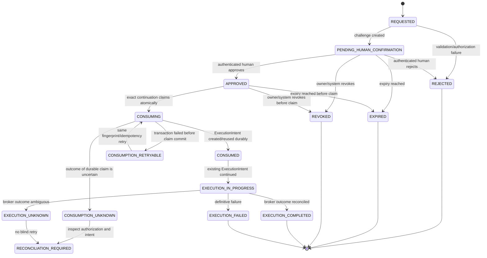
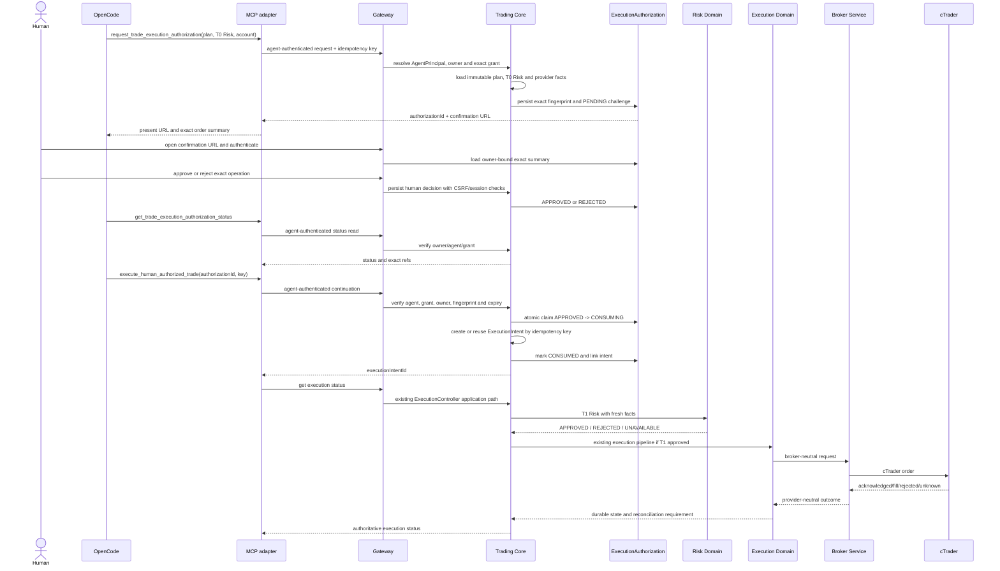

# ADR-098 - Human-Authorized MCP Trading Execution Continuation

## Status

ACCEPTED - human architecture approval recorded 2026-11-12

## Date

2026-11-12

## Decision Makers

- Trading OS Architecture
- Human Engineer
- Project Owner

## Decision Type

Human-authorized execution continuation from OpenCode/MCP through Trading Core

## Related ADRs

- ADR-029 - Execution Domain Architecture
- ADR-041 - Human-Controlled Trade Execution and Financial Command Safety
- ADR-044 - Service-to-Service Trust and Actor Propagation
- ADR-048 - Intelligence Evidence and Authority
- ADR-088 - MCP-First Agent Interaction Boundary
- ADR-089 - Native Trading Research Agent and MCP Responsibility Boundary
- ADR-090 - Agent Identity, Permissions and Delegated Authorization
- ADR-092 - Proposed MCP Research Operational Control Boundary

ADR-098 supersedes ADR-090 only for the narrowly bounded, exact, human-approved
MCP execution continuation defined here. ADR-090 remains authoritative for agent
identity, token exchange, grants, principal separation and default-deny behavior.

## Related Investigation

- `docs/architecture/reports/trading-workflow-mcp-architecture-review-2026-11-12.md`

## 1. Context

Trading OS is an AI-assisted discretionary trading platform. The product owner
has selected the following interaction model for the existing
`FTMO Free cTrader` account:

```text
OpenCode/MCP conversation
    -> research and opportunity preparation
    -> immutable TradePlan
    -> deterministic T0 Risk evaluation
    -> strong human authorization initiated from OpenCode
    -> MCP execution continuation
    -> Trading Core T1 Risk revalidation
    -> existing Execution Domain
    -> Broker Service
    -> broker outcome and reconciliation
```

The target account is `ExecutionMode.LIVE`. The display name must not be used to
infer a paper or demo safety boundary. Any external cTrader boundary is live
from Trading OS's perspective.

The current repository already provides most of the deterministic execution
path:

- `TradePlan` versions and lifecycle;
- persisted T0 Risk evaluations;
- `ExecutionIntent` and `ExecutionAttempt` identities;
- server-side T1 Risk revalidation;
- idempotency and optimistic lifecycle protection;
- Broker Service provider isolation;
- broker outcome classification and reconciliation;
- agent identity, grants and Gateway-only MCP access.

The current MCP adapter can create an opportunity-origin TradePlan, request
Risk evaluation and create/read a human approval challenge. It cannot create
or execute an `ExecutionIntent`, and its approved-agent operation endpoint is
limited to account synchronization.

The current `TradePlanApprovalChallenge` is not yet an execution authorization
object. It binds an agent, owner, trading account, TradePlan version, Risk
evaluation, digest and expiry. It currently supports `PENDING`, `APPROVED`,
`REJECTED`, `EXPIRED` and `INVALIDATED`, but has no atomic execution-consumption
state. Its digest is calculated from the plan projection and does not by itself
bind every execution identity required by this ADR, including an execution
idempotency key and all provider/product facts.

ADR-090 currently excludes agent order execution. This ADR therefore proposes a
new bounded continuation model and an explicit ADR-090 supersession/amendment
strategy. It does not authorize a specific order or any runtime execution.

## 2. Problem Statement

OpenCode needs to initiate a trusted human authorization flow from the
conversation and, only after that authorization, continue one exact approved
execution through the existing Trading Core path.

The design must avoid these unsafe shortcuts:

- treating conversational language as human authorization;
- treating an agent grant as order authorization;
- treating T0 Risk approval as execution authorization;
- treating approval of a TradePlan as permission to change its parameters;
- allowing the agent to approve its own request;
- sending a direct MCP-to-Broker Service request;
- creating a second execution engine;
- retrying a broker operation after an unknown outcome;
- allowing a consumed authorization to authorize a future order.

## 3. Decision Drivers

The design is evaluated against:

1. Exact account, provider, market and order binding.
2. Strong authenticated human identity.
3. Agent/human principal separation.
4. Single-use and replay-resistant authorization.
5. Reuse of existing Angular authentication and Trading Core services.
6. Existing T0/T1 Risk and Execution Domain invariants.
7. Idempotent continuation after MCP retries or agent restart.
8. Clear handling of rejection, expiry, revocation and uncertainty.
9. Auditable decisions without reusable secrets in OpenCode.
10. Practical conversation-driven user experience.

## 4. Authority Separation

### 4.1 AI and OpenCode authority

OpenCode and the Java-controlled Research Agent may:

- interpret evidence and expose contradictions;
- propose an opportunity and execution parameters;
- prepare an immutable TradePlan;
- request a human authorization challenge;
- read authorization and execution status;
- invoke a continuation only when the server reports an approved,
  unconsumed, exact authorization.

They must not:

- approve an authorization challenge;
- alter the authorized order parameters;
- choose a different account or market during continuation;
- bypass Trading Core, Risk or Broker Service;
- treat an approval as reusable authority;
- infer authorization from user conversation or tool output.

### 4.2 Human authority

The authenticated human owner reviews and approves or rejects the exact
execution proposal through a trusted confirmation surface launched from the
OpenCode flow. The human decision is bound to the server-generated operation
fingerprint and is recorded with identity and timestamp.

The human cannot override a deterministic Risk rejection, an ownership failure,
an invalid market identity, an expired operation or provider safety controls.

### 4.3 Deterministic system authority

Trading Core remains authoritative for:

- owner, agent and broker-account resolution;
- exact resource grants;
- immutable TradePlan and Risk references;
- authorization fingerprint validation;
- atomic authorization consumption;
- ExecutionIntent creation or reuse;
- T1 Risk revalidation;
- idempotency and execution lifecycle;
- Broker Service delegation;
- unknown outcome and reconciliation state.

## 5. Strong Human Authorization Mechanism

### 5.1 Option comparison

| Option | Security | UX | Complexity | Assessment |
|---|---|---|---|---|
| A. Secure confirmation link | Strong when single-use, short-lived, HTTPS, owner-bound, CSRF-protected and re-authenticated | Excellent; OpenCode presents a link and the human can use another device | Reuses existing web auth but requires a focused route and challenge contract | Suitable |
| B. Dedicated confirmation interface | Strong; same controls as A with a focused order review | Excellent; purpose-built and less distracting than the full trading workflow | Slightly more frontend surface; still reuses identity infrastructure | Recommended implementation surface |
| C. Native MCP/OpenCode approval prompt | Not proven to bind a server-authenticated human identity, exact order fingerprint, CSRF/session or independent approval audit | Lowest friction | Low apparent effort but high trust uncertainty | Reject for financial authorization |

### 5.2 Chosen mechanism

Adopt **Option A as the transport and Option B as the presentation**:

- Trading Core creates a server-owned, short-lived execution authorization
  challenge.
- The public Gateway returns a one-time HTTPS confirmation URL containing only
  an opaque challenge identifier, never an approval secret or broker credential.
- OpenCode presents that URL in the conversation.
- A minimal dedicated confirmation page is opened from the URL. It uses the
  existing authenticated human session and requires reauthentication or an
  equivalent strong confirmation step according to the existing identity
  policy.
- The page displays the exact account, provider, canonical market/product,
  direction, order type, quantity, protections, price constraints, Risk result,
  expiry and warning state.
- The human approves or rejects through the authenticated web endpoint.
- OpenCode polls the authorization status through MCP.

This avoids a new authentication system and avoids treating MCP tool approval
or conversational consent as a financial authorization boundary.

### 5.3 Required confirmation controls

The confirmation surface must:

- require an authenticated human principal, not an agent principal;
- resolve the owner from the session, never from URL or request body;
- verify the challenge belongs to that owner;
- use an opaque, high-entropy, single-use challenge identifier;
- expire challenges quickly and visibly;
- apply CSRF protection to approval/rejection mutations;
- display the exact fingerprint inputs in human-readable form;
- prevent approval after expiry, revocation, consumption or parameter change;
- record approver identity, timestamp, decision and correlation ID;
- avoid exposing broker credentials, agent credentials or reusable approval
  tokens to OpenCode.

## 6. Exact Execution Authorization Contract

Introduce a separate server-owned `ExecutionAuthorization` model, or extend
the existing challenge only if the resulting lifecycle and persistence remain
semantically distinct from ordinary TradePlan acceptance.

The recommended model is a separate execution authorization record linked to,
but not merged with, `TradePlanApprovalChallenge`:

```text
executionAuthorizationId
humanUserId
agentId
grantId / grantVersion
brokerAccountId
tradingAccountId
providerRegistrationId
providerIdentity
canonicalMarketId
providerSymbol / productIdentity
tradePlanId
tradePlanVersion
riskEvaluationId
direction
orderType
quantity
entryPriceConstraint
stopLoss
takeProfit
protectionParameters
executionIdempotencyKey
requestFingerprint
createdAt
expiresAt
decision
decidedAt
decidedByHumanUserId
consumedAt
consumedByAgentId
executionIntentId
status
version
```

The fingerprint must be calculated by Trading Core from canonicalized
server-owned values, not from arbitrary MCP JSON. It must include at least:

```text
owner user ID
agent ID
broker account ID
Trading Account ID
provider registration/identity
canonical market ID
provider symbol/product identity
TradePlan ID/version
Risk evaluation ID and decision
direction
order type
quantity
entry price or bounded price constraint
stop loss
take profit and protection parameters
execution idempotency key
```

Provider payloads and credentials are not part of the public MCP contract.

If any bound parameter changes, the authorization is invalidated. The system
must create a new TradePlan version, Risk evaluation, execution idempotency key
and authorization challenge. It must never mutate the approved record to match
the changed request.

An authorization is not a standing grant. It authorizes only the one exact
operation represented by the fingerprint and only within its expiry window.

## 7. Authorization Lifecycle



### 7.1 Atomicity and transaction protocol

The authorization claim and `ExecutionIntent` creation should be one Trading
Core database transaction because both are Trading Core-owned durable state:

1. Load authorization with an optimistic version or row lock.
2. Verify `APPROVED`, owner, agent, grant, expiry, fingerprint and unused
   state.
3. Resolve the authoritative TradePlan and execution parameters from
   persistence; never trust MCP-supplied order fields.
4. Create or locate the `ExecutionIntent` by its immutable idempotency key.
5. Verify the intent references the same TradePlan, Risk evaluation, account and
   parameters.
6. Mark authorization `CONSUMED` with the intent ID.
7. Commit the transaction.

The broker call must not occur inside this transaction. The subsequent
continuation invokes the existing `ExecuteTradeService`, which performs T1 Risk
and the existing broker pipeline after durable state exists.

If the transaction rolls back, the authorization remains available for the same
fingerprint and idempotency key. If commit outcome is ambiguous, the retry must
first read the authorization and idempotency records. It must reuse an existing
intent and must not create a second one.

If broker submission is ambiguous, the existing `UNKNOWN` and reconciliation
semantics apply. Authorization consumption is not undone and the order is not
blindly resubmitted.

### 7.2 Existing approval compatibility

The current `TradePlanApprovalChallenge` may remain the human plan decision
surface. A new execution authorization challenge should be created only after:

- the TradePlan is immutable and accepted;
- T0 Risk is complete and approved;
- the exact broker account and provider facts are resolved;
- the execution parameters are derived server-side.

This prevents one approval object from silently changing meaning. If product
owners decide that the existing challenge should be promoted instead, its
schema and lifecycle must be amended explicitly and all old pending challenges
must be treated conservatively.

## 8. MCP and Gateway Contracts

The MCP adapter remains a thin public Gateway client. No direct Broker Service,
cTrader, repository or database route is introduced.

### 8.1 Proposed tools

```text
request_trade_execution_authorization(
  trade_plan_id,
  trade_plan_version,
  broker_account_id,
  risk_evaluation_id,
  execution_idempotency_key
)
  -> execution_authorization_id, confirmation_url, exact summary, expires_at

get_trade_execution_authorization_status(
  execution_authorization_id
)
  -> status, fingerprint, decision, expiry, human decision metadata,
     execution_intent_id when consumed

execute_human_authorized_trade(
  execution_authorization_id,
  execution_idempotency_key
)
  -> execution_intent_id, execution status, continuation outcome

get_trade_execution_status(
  execution_intent_id,
  broker_account_id
)
  -> execution intent, attempts, broker-neutral outcome and recovery action
```

The request tool does not authorize or execute. The status tool does not
authorize. The continuation tool is the only MCP mutation that may cause the
existing entry execution path to run, and only after server-side authorization
consumption.

### 8.2 Gateway contracts

The public contracts should be new explicit application routes, for example:

```text
POST /api/v1/agent/execution-authorizations
GET  /api/v1/agent/execution-authorizations/{authorizationId}
POST /api/v1/agent/execution-authorizations/{authorizationId}/continue
GET  /api/v1/agent/executions/{executionId}

GET  /api/v1/execution-authorizations/{authorizationId}
POST /api/v1/execution-authorizations/{authorizationId}/approve
POST /api/v1/execution-authorizations/{authorizationId}/reject
POST /api/v1/execution-authorizations/{authorizationId}/revoke
```

The exact paths remain an implementation decision. The human routes must accept
only a human principal; the agent routes must accept only an agent principal.
The public response must not expose reusable challenge secrets or provider
credentials.

### 8.3 Permission model

Do not add a standing `orders:execute` permission. Use narrowly scoped
permissions with separate meanings:

| Permission | Meaning | Resource | Financial side effect |
|---|---|---|---|
| `executions:request` | Agent may request a human authorization for an exact TradePlan/Risk/account tuple | Exact broker account | None |
| `executions:status:read` | Agent may read its own authorized execution status | Exact broker account and/or intent | None |
| `executions:continue-approved` | Agent may submit a previously approved exact authorization for server validation and consumption | Exact broker account | Potentially starts existing Execution Domain |

`executions:continue-approved` is not sufficient by itself. Effective
authorization is:

```text
valid agent token
AND active agent identity
AND active exact broker-account grant
AND operation permission
AND owner/account match
AND approved unexpired exact ExecutionAuthorization
AND unused authorization
AND exact fingerprint/idempotency match
AND existing TradePlan/Risk/Execution validations
```

The permissions must not inherit across accounts, agents, users, plans or future
operations. Revoking the grant denies a not-yet-consumed continuation. Once an
execution has been consumed, revocation cannot erase the financial history or
cancel the broker side effect; it only prevents further continuation requests
where the lifecycle permits.

## 9. Execution Continuation Sequence



## 10. LIVE Execution Preconditions

No runtime verification or order submission is performed by this ADR. Before a
future real execution validation, Trading Core and operators must verify:

1. Authenticated owner and exact internal `BrokerAccount.id` for
   `FTMO Free cTrader`.
2. Provider registration and external account binding.
3. `ExecutionMode.LIVE` and current connection/readiness state.
4. Canonical EUR/USD market ID, cTrader symbol and CFD product identity.
5. Contract size, quantity step/minimum and currency mapping.
6. Current account balance, equity, margin, open positions and exposure.
7. Current market tradability, quote freshness, spread and slippage policy.
8. Entry order type and price semantics.
9. Stop-loss and take-profit protection mapping.
10. Applicable FTMO/challenge risk profile and current limits.
11. T0/T1 Risk facts and fail-closed behavior.
12. Broker Service ownership, idempotency and reconciliation readiness.
13. Provider-side acknowledgement versus fill semantics.
14. Recovery behavior for timeout and unknown outcome.

These are gates for a future explicitly approved runtime validation, not implied
by this proposal.

## 11. Threat Model

| Threat | Attack path | Boundary | Preventive control | Audit/detection | Required test |
|---|---|---|---|---|---|
| Prompt injection | Market/news text instructs OpenCode to execute | AI is non-authoritative | Only server authorization and human page can approve | Research provenance, agent request and human decision events | Malicious evidence never creates authorization |
| Agent self-approval | Agent calls human approve route or forges user identity | Human endpoint requires human principal | Separate principals and route authorization | Denied principal audit | Agent token on approve endpoint is rejected |
| Forged human approval | Caller submits owner/approver ID | Owner resolved from authenticated session | Ignore body/header actor fields | Decision identity from security context | Cross-user and forged-owner tests |
| Confused deputy | Agent asks Trading Core to use another user's account | Trading Core owns account/grant checks | Exact owner and broker-account grant | Authorization decision with owner/resource | User A agent targeting User B denied |
| Approval replay | Reuse approved challenge | Authorization lifecycle | Atomic `APPROVED -> CONSUMING -> CONSUMED`, version/unique constraints | Consumption event and linked intent | Two concurrent continuation calls produce one intent |
| Parameter substitution | MCP changes quantity after approval | Server fingerprint | Derive parameters from plan and compare fingerprint | Mismatch event/reason | Quantity, SL/TP, direction and order-type mismatch rejected |
| Account substitution | Continuation changes broker account | Server account binding | Exact account in authorization and plan | Account IDs in audit | Wrong account rejected |
| Market substitution | Symbol text maps to another product | Canonical market/provider/product identity | Server-resolved identity and fingerprint | Identity fields and provider ref | EUR/USD wrong product/provider rejected |
| Stale T0 Risk | Approved evaluation is reused after market/account changes | T1 Risk gate | Existing `ExecutionTimeRiskRevalidationService` | Separate T0/T1 persistence | T1 rejection prevents broker call |
| Price movement | Price changes after human confirmation | Execution Domain/T1 and plan constraints | T1 fresh valuation and exact plan parameters | T1 facts and decision | Changed price/constraint behavior tested |
| Concurrent continuation | Multiple MCP calls race | Trading Core database | Optimistic lock/row lock and idempotency | Conflict and reuse events | Concurrent calls yield one intent |
| Duplicate broker submission | Retry after request timeout | Execution Domain | One active attempt and broker correlation | Attempt/outcome events | Duplicate HTTP/MCP retries do not submit twice |
| MCP transport retry | Client retries POST | Idempotency key | Retry same fingerprint only | Idempotency conflict audit | Same key reuse and changed payload tests |
| Broker timeout | cTrader response is lost | Broker/Execution boundary | `UNKNOWN`, reconciliation before retry | Unknown/reconciliation events | Timeout never auto-resubmits |
| Compromised agent credential | Attacker uses agent token | Gateway/Trading Core grants | Short-lived token, revocable exact grants | Token/authorization audit without secrets | Revoked/expired agent denied |
| Approval-link leakage | URL is copied or logged | Confirmation challenge | Opaque short-lived ID, human session binding, no secret authority | Access and decision audit | Wrong user/device cannot approve |
| CSRF | Malicious site submits approve POST | Browser human boundary | CSRF protection, SameSite policy, origin checks | Failed CSRF/security logs | Cross-origin approval denied |
| Misleading tool output | Agent reports approved/executed without server state | OpenCode is presentation only | MCP returns signed/authoritative IDs/status; UI wording from state | Correlation and status history | Unknown/partial states remain visible |
| Authorization revocation race | Grant revoked while continuation starts | Trading Core transaction | Recheck grant during atomic claim | Denial/claim outcome audit | Revocation versus claim concurrency test |

LLM text, MCP tool availability and user conversational language are never
authorization boundaries.

## 12. Alternatives Considered

### 12.1 Native MCP/OpenCode confirmation only

Rejected. The runtime does not currently prove an authenticated human identity,
exact server fingerprint binding, CSRF/session protection or durable financial
approval audit independent of model-generated text.

### 12.2 Reuse the current TradePlan approval as execution authorization

Rejected as an implicit change of meaning. The current challenge is useful for
human plan acceptance but lacks the complete execution-consumption lifecycle.
It may be extended only through an explicit schema/lifecycle decision and
migration treatment for old challenges.

### 12.3 Add a standing `orders:execute` agent grant

Rejected. It would turn a durable grant into standing financial authority and
would weaken the exact-operation human boundary.

### 12.4 Direct MCP-to-Broker Service execution

Rejected by ADR-029, ADR-044, ADR-088 and ADR-090. It would bypass Trading Core
ownership, Risk, ExecutionIntent, idempotency and reconciliation.

### 12.5 Build a second MCP-specific execution engine

Rejected. The existing Execution Domain already models the required lifecycle.
MCP should expose a continuation command that enters that domain.

### 12.6 Require Angular's complete trading workflow

Rejected as the product experience. A dedicated focused confirmation surface
launched from OpenCode is less friction while preserving the existing trusted
identity mechanism and explicit human decision.

## 13. Consequences

### Positive

- OpenCode can initiate the complete human authorization experience.
- The exact approved operation is bound to immutable server-owned data.
- Agent identity remains distinct from human authorization.
- Existing Trading Core Risk, Execution Domain and Broker Service controls are
  reused.
- Authorization replay and parameter substitution become explicit failure modes.
- Broker unknown outcomes retain existing reconciliation semantics.
- The user does not need to navigate the full Angular trading workflow.

### Costs and tradeoffs

- A new execution authorization lifecycle and persistence model are required.
- A focused confirmation surface and human session/CSRF controls are required.
- MCP gains a carefully constrained financial continuation capability.
- ADR-090 is narrowly superseded for this continuation protocol; its retained
  identity, grant and default-deny decisions remain authoritative.
- Atomic authorization consumption requires concurrency and migration testing.
- Runtime validation against the existing LIVE cTrader account remains a separate
  gated activity.

## 14. ADR-090 Compatibility and Supersession Strategy

ADR-090 remains authoritative for agent identity, token exchange, grants,
principal separation and default-deny behavior. Its current
`AGENT_ORDER_EXECUTION = NOT_AUTHORIZED` rule is narrowly superseded only for
the exact continuation protocol defined by this ADR.

This ADR adopts a **narrow supersession** rather than rewriting ADR-090:

- ADR-090 continues to define agent identity, token exchange, grants, principal
  separation and default deny.
- ADR-098 narrows the exception to a server-owned, human-approved, exact,
  single-use execution authorization.
- ADR-098 explicitly rejects standing execution grants and autonomous trading.
- ADR-090's non-goal "agent order execution" is superseded only for the exact
  continuation protocol defined here. Implementation remains gated by Story 0231
  approval and its security acceptance.

If the project prefers amendment rather than supersession, ADR-090 must receive
a new numbered amendment record; its historical text should not be silently
rewritten.

## 15. Compatibility and Migration

- Existing human `/api/v1/executions/**` routes remain unchanged.
- Existing Angular plan/Risk/execution behavior remains valid.
- Existing agent grants remain default-deny; no existing grant gains execution
  authority automatically.
- Existing `TradePlanApprovalChallenge` rows remain valid for plan decisions and
  are not silently treated as execution authorizations.
- New execution authorization tables should be introduced through a reviewed
  migration with unique constraints for authorization ID, idempotency identity
  and one consumed intent linkage.
- Existing MCP tools remain functional and bounded.
- The MCP adapter adds only public Gateway mappings and never provider access.
- Broker Service contracts remain unchanged unless a server-side audit context
  extension is proven necessary through the existing service-JWT boundary.
- Feature rollout should be disabled until human approval of ADR-098 and the
  Story security tests.

## 16. Explicit Non-Goals

This ADR does not authorize or implement:

- a specific broker order;
- autonomous trading or conversational implicit approval;
- standing `orders:execute` grants;
- position modification, close or cancellation through this continuation;
- direct Broker Service/cTrader access from MCP;
- changes to deterministic Risk rules;
- a new broker or cTrader adapter;
- a PAPER or DEMO execution environment;
- remote MCP OAuth or a new identity provider;
- persistent hypothesis/monitoring orchestration;
- changing the Research milestone;
- deployment, restart, credentials, grant changes or live runtime validation.

## 17. Proposed Acceptance Criteria

Human architecture acceptance of this ADR should require confirmation that:

1. The secure confirmation link plus dedicated focused page is the chosen human
   authorization mechanism.
2. Native MCP/OpenCode confirmation alone is insufficient.
3. `ExecutionAuthorization` is exact, immutable, expiring and single-use.
4. Agent grant and human authorization remain separate controls.
5. Authorization consumption and `ExecutionIntent` creation use a recoverable
   idempotent protocol, preferably one Trading Core transaction.
6. Existing T1 Risk and Execution Domain services remain authoritative.
7. Unknown broker outcomes require reconciliation and never blind retry.
8. No standing execution grant or autonomous agent order authority is created.
9. ADR-090 is superseded or amended explicitly before implementation.
10. The first Story is limited to the smallest safe vertical slice described in
    `0231-secure-mcp-execution-authorization-and-continuation/story.md`.

## 18. Open Questions

1. Is reauthentication required for every execution authorization, or is an
   authenticated owner session plus step-up confirmation sufficient?
2. Which existing human identity mechanism provides the acceptable step-up
   assurance for the FTMO LIVE boundary?
3. Should `TradePlanApprovalChallenge` remain a separate plan-decision object,
   or should a new execution authorization be layered after it?
4. Which provider/product fields are authoritative for the fingerprint in the
   current cTrader contract?
5. What is the exact challenge TTL and whether owner revocation is required
   before consumption?
6. Should the agent be permitted to request continuation after human approval,
   or should the confirmation page itself issue the continuation nonce?
7. What audit persistence failure policy applies to human approval and atomic
   consumption?
8. What authenticated read-only runtime checks are mandatory before enabling the
   first LIVE execution validation?

## 19. Summary

The proposed architecture gives OpenCode a practical conversational continuation
without making OpenCode an execution authority:

```text
AI proposes
  -> Trading Core binds exact operation
  -> authenticated human approves exact operation
  -> Trading Core consumes authorization once
  -> existing T1 Risk and Execution Domain run
  -> Broker Service submits/reconciles
```

The design is **PROPOSED** only. It does not authorize implementation or any
broker operation.
