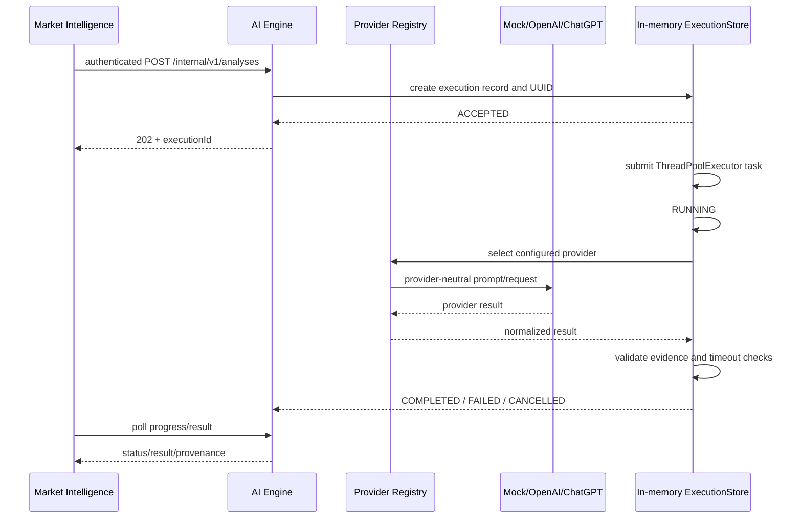
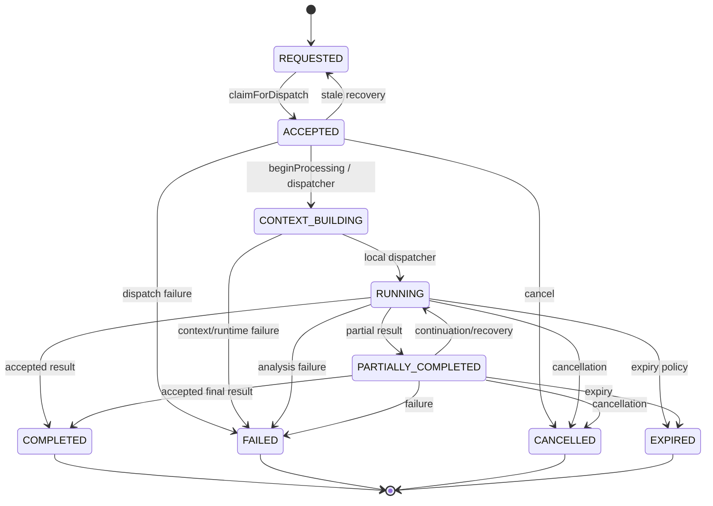
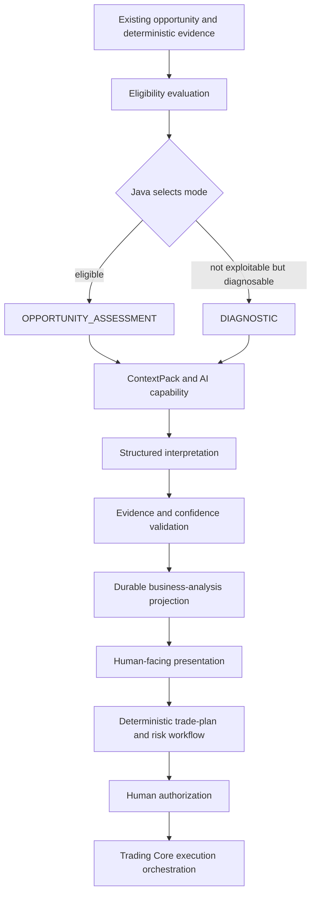

# D2 - Architecture and Runtime Flows

## Existing AI Engine Runtime Flow

The AI Engine creates the execution ID from the request supplied by Market
Intelligence; it does not generate a second business-analysis identifier. The
store returns an existing record when the same execution ID and request
fingerprint are resubmitted, and rejects reuse with a different fingerprint.
Evidence: `ai-engine/app/infrastructure/execution_store.py:47-61,165-167`.

The AI Engine timeout is checked before and after provider invocation. Active
provider interruption is not verified. Cancellation is cooperative through an
event; `Future.cancel()` only succeeds for work that has not started. Evidence:
`ai-engine/app/infrastructure/execution_store.py:63-106,146-163`.

Provider fallback is distinct from execution retry: the registry invokes the
fallback after `RuntimeError` or `ValueError`, while no AI Engine execution
retry loop is established. Evidence: `provider_registry.py:12-43`.

## Durable Market Intelligence Execution Flow

The durable lifecycle is owned by Market Intelligence, persisted through
`AnalysisExecutionRepository`, and recovered for stale accepted executions.
Evidence: `AnalysisExecutionService.java:48-58,278-337`;
`AnalysisExecution.java:15-49`; `AnalysisExecutionRepository.java:14-48`.

## Epic 0248 Interpretation

Epic 0248 can reuse the durable Market Intelligence execution lifecycle and the
existing AI Engine adapter without creating a second execution orchestrator.
The two stores have different responsibilities:

| State | Owner | Durability | Epic implication |
|---|---|---|---|
| Provider invocation and temporary AI result | AI Engine `ExecutionStore` | Process-local | Restart can lose the in-flight AI record |
| Technical analysis execution, status, policy, provenance, result | Market Intelligence `AnalysisExecution` | Durable database-backed aggregate | Reusable for Epic request tracking |
| Research report/history | Market Intelligence `ResearchExecution` | Durable report/status/attempt storage | Existing history pattern, but not Epic-specific mode history |
| Opportunity lifecycle and eligibility | Market Intelligence | Durable versioned domain state | Authority for mode selection inputs |

## Proposed Epic 0248 Flow

## Responsibility Boundaries

| Responsibility | Owner | Boundary |
|---|---|---|
| Market context assembly | Market Intelligence | Deterministic context and evidence selection |
| AI interpretation | AI Engine/provider abstraction | Advisory interpretation only |
| Provider credentials and payloads | AI Engine infrastructure | Must not leak into domain/public contracts |
| Evidence validation | AI Engine plus Market Intelligence report mapping | References must remain traceable |
| Opportunity/risk authority | Market Intelligence and deterministic risk domain | AI cannot override decisions |
| Execution authority | Trading Core and Broker Service | Outside AI Engine |
| Human approval | Trading OS Web / Trading Core workflow | Required before execution |

## Proposed Epic 0248 Flow

The proposed flow reuses the existing AI Engine only for interpretation and
validation. ContextPack assembly, opportunity eligibility, risk, approval, and
execution remain outside the model/provider boundary.

## Failure and Safety Flow

- Invalid structured output is rejected before it becomes a completed AI
  execution.
- Missing or invalid evidence references prevent a grounded result from being
  treated as complete.
- Provider failure is translated into an explicit failed or partial result;
  it is not a trading decision.
- AI Engine cancellation and timeout are bounded, but active provider
  interruption is unverified.
- Unknown execution outcomes remain unknown and require reconciliation; they
  must not be interpreted as broker rejection or approval.
- AI Engine process restart loses its in-memory execution records; Market
  Intelligence durable records can be recovered, but the provider invocation
  cannot be assumed to have completed or to be safely replayable.
