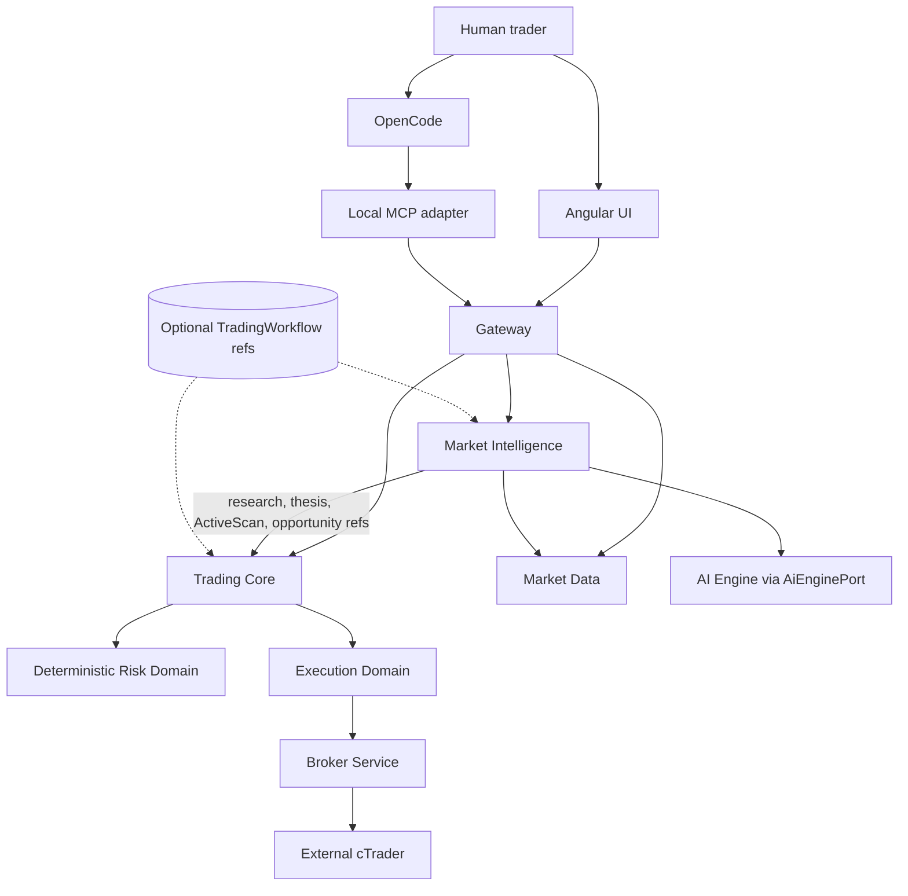
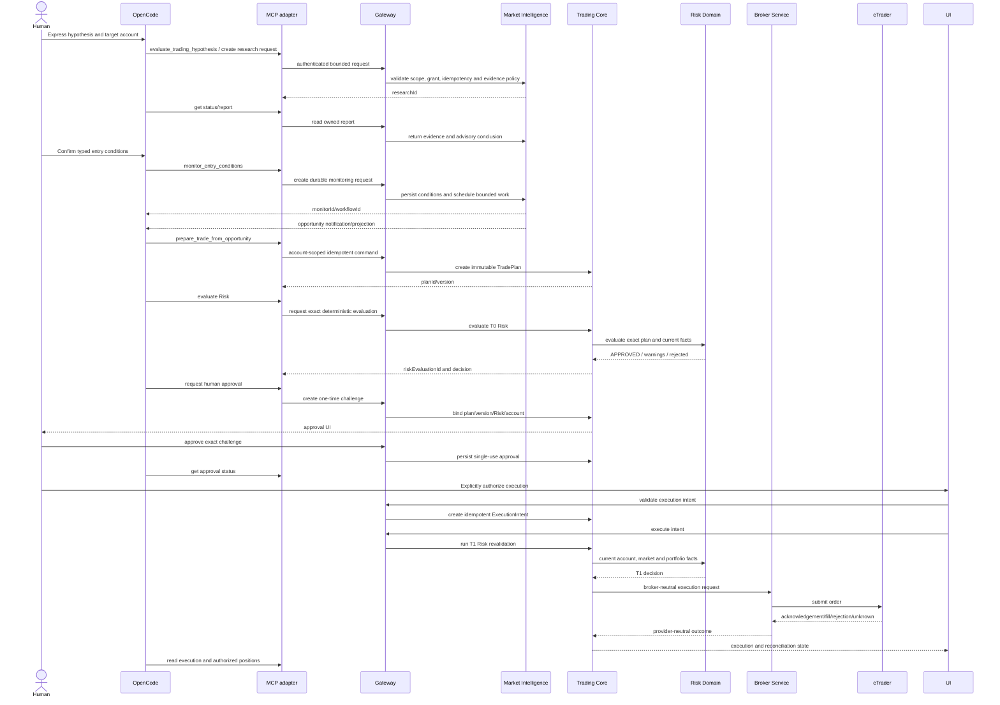

# Trading OS Hypothesis-to-Execution Workflow Architecture Review

**Date:** 2026-11-12
**Priority:** P0
**Mode:** Read-only repository investigation and architectural proposal
**Target:** Human UI and OpenCode/MCP parity for the existing `LIVE` trading boundary

## 1. Executive Summary

Trading OS already implements the core human-controlled trading workflow:

```text
account and market selection
  -> opportunity or manual TradePlan
  -> TradePlan acceptance
  -> deterministic T0 Risk evaluation
  -> explicit human execution action
  -> server-side T1 Risk revalidation
  -> Trading Core Execution Domain
  -> Broker Service
  -> broker outcome and reconciliation
```

The Angular workflow is implemented and covered by focused tests. PAPER
execution has historical runtime evidence. The current repository does not
provide current end-to-end proof of an external cTrader execution, so the
`FTMO Free cTrader` account must remain an explicitly selected `LIVE` target,
not an assumed safe demo target.

The MCP surface is materially behind the human UI but is no longer only a
research prototype. It currently provides:

- bounded research start/status/report operations;
- active scan start/status;
- market, thesis and opportunity reads;
- authorized account, status and position reads;
- opportunity-origin TradePlan creation;
- deterministic TradePlan Risk evaluation;
- human approval challenge creation and status;
- bounded account synchronization requests;
- bounded historical research readiness and export operations.

The decisive gap is that MCP has no capability to create or submit a Trading
Core `ExecutionIntent`, execute an approved TradePlan, or retrieve execution
state. `execute_approved_agent_operation` is currently limited to approved
account synchronization, not trading. Therefore the target workflow is not
yet MCP-complete.

The recommended architecture is phased:

1. **MCP parity:** expose the existing account-scoped TradePlan read, Risk,
   approval and execution-status contracts without duplicating business logic.
2. **Workflow continuity:** introduce a thin durable `TradingWorkflow`
   coordinator only when the hypothesis must survive research, monitoring and
   later preparation. It should reference existing IDs rather than duplicate
   their state.
3. **Entry monitoring:** extend the existing persisted `ActiveScan` model with
   explicit, deterministic entry-condition semantics and scheduled/event-driven
   dispatch. Do not use a long-running MCP or LLM loop.
4. **Conversational ergonomics:** add high-level MCP operations that compose
   existing deterministic endpoints while preserving one exact approval and one
   exact execution boundary.

This is not a PAPER redesign and does not create a parallel execution path.

## 2. Evidence Classification

The following labels are used throughout this report:

- `IMPLEMENTED_AND_E2E_VERIFIED`: repository evidence includes a successful
  current or historical end-to-end runtime path for the stated scope.
- `IMPLEMENTED_AND_TESTED`: implementation and automated tests exist, but the
  requested end-to-end runtime path was not verified here.
- `IMPLEMENTED_NOT_VALIDATED`: implementation exists, but relevant current
  runtime or integration evidence is missing.
- `PROPOSED`: architectural recommendation, not implementation.
- `MISSING`: no relevant implementation was found.

The report distinguishes repository evidence from runtime claims. Code and
tests do not prove that the current deployed services, account grants or
provider connection are ready.

## 3. Current Human Workflow

### 3.1 User-facing sequence

The current Angular routes include:

- `/opportunities` for active opportunities and scan results;
- `/decision-workspace` for the plan/risk/execution workspace;
- `/trade-planning/manual` for a human-authored TradePlan;
- `/trade-planning/plans/:planId/versions/:version` for plan lifecycle;
- `/positions` for account and position views.

Relevant UI files include:

- `trading-os-web/src/app/features/opportunities/opportunities.ts`;
- `trading-os-web/src/app/features/opportunities/opportunity-details/opportunity-details.ts`;
- `trading-os-web/src/app/features/opportunities/scan-panel/scan-panel.ts`;
- `trading-os-web/src/app/features/trade-planning/manual-trade-page/manual-trade-page.ts`;
- `trading-os-web/src/app/features/trade-planning/manual-trade-ticket/manual-trade-ticket.ts`;
- `trading-os-web/src/app/features/trade-planning/plan-page/plan-page.ts`;
- `trading-os-web/src/app/features/trade-planning/approval-page/approval-page.ts`.

The normal opportunity-origin sequence is:

```text
User selects account/context
    -> User selects or opens an opportunity
    -> Create opportunity-origin TradePlan
    -> Read TradePlan projection
    -> Human accepts the proposed plan
    -> Request deterministic Risk evaluation (T0)
    -> Risk APPROVED or APPROVED_WITH_WARNINGS
    -> Human explicitly clicks Execute
    -> Create validated ExecutionIntent
    -> Server-side T1 Risk revalidation
    -> Broker submission through Trading Core -> Broker Service
    -> Poll execution state
    -> COMPLETED, FAILED, UNKNOWN, or recovery/reconciliation
```

The manual-origin path starts at the manual TradePlan ticket and joins the
same plan, Risk and execution lifecycle. This is important: MCP should not
create a second execution pipeline for conversational trades.

### 3.2 Human REST and application mapping

| Stage | UI action and REST | Application/domain boundary | Evidence and status |
|---|---|---|---|
| Account selection | Account services and broker-account context | Trading Core account and broker-account ownership | `IMPLEMENTED_AND_TESTED`; current account readiness not runtime-verified |
| Market selection | Market catalogue and tradable-market reads | Market Data market identity, constraints and freshness | `IMPLEMENTED_AND_TESTED`; unfiltered MCP catalogue is too large for its default response limit |
| Scan/opportunity | Opportunities page and scan panel | Market Intelligence `ActiveScan`, `AnalysisExecution`, observations, StrategyMatch and `TradingOpportunity` | `IMPLEMENTED_AND_E2E_VERIFIED` for the historical PAPER journey; current external runtime not verified |
| Opportunity plan | `POST /api/v1/trade-plans/opportunities/{opportunityId}/trade-plans` | Trading Core `OpportunityTradePlanOrchestrationService`, Market Intelligence planning contract | `IMPLEMENTED_AND_TESTED`; no current live E2E |
| Manual plan | `POST /api/v1/trade-plans/manual` | `ManualTradePlanOrchestrationService` and effective planning profile | `IMPLEMENTED_AND_TESTED` |
| Plan decision | `POST /api/v1/trade-plans/{planId}/versions/{version}/decisions` | TradePlan decision lifecycle and immutable version semantics | `IMPLEMENTED_AND_TESTED` |
| T0 Risk | `POST /api/v1/trade-plans/{planId}/versions/{version}/risk-evaluations` | `TradePlanRiskEvaluationService` and deterministic `RiskEngine` | `IMPLEMENTED_AND_TESTED`; no agent/current-account E2E verified here |
| Human approval | `GET/POST /api/v1/trade-plan-approvals/{id}` and `/approve` or `/reject` | `TradePlanApprovalService`, owner-bound challenge and single-use decision | `IMPLEMENTED_AND_TESTED`; human UI is separate from broker submission |
| Execution validation | `POST /api/v1/executions/validate` | `ValidateAndCreateService`, ownership, accepted plan, approved Risk, account mapping and idempotency | `IMPLEMENTED_AND_TESTED`; only user-authenticated route exists |
| Execution | `POST /api/v1/executions/{id}/execute` | Trading Core Execution Domain pipeline | `IMPLEMENTED_AND_TESTED`; current cTrader external execution not validated |
| T1 Risk | Internal execution-time revalidation | `ExecutionTimeRiskRevalidationService`, current broker facts and valuation | `IMPLEMENTED_AND_TESTED` in current source/tests; current provider runtime not validated |
| Broker submission | `POST /internal/v1/executions` | Trading Core broker-neutral port -> Broker Service -> cTrader adapter | `IMPLEMENTED_AND_TESTED`; provider outcome remains runtime-unknown |
| Outcome/recovery | `GET /api/v1/executions/{id}`, `/reconcile`, retry/retry-T1 | Execution attempt/order lifecycle and broker reconciliation | `IMPLEMENTED_AND_TESTED` |
| Position state | Positions/dashboard and broker snapshot path | Trading Core read model; Broker Service authoritative provider facts for LIVE | `IMPLEMENTED_AND_TESTED`; current FTMO account state not inspected |

### 3.3 Human workflow validation

The repository contains:

- Angular plan-page tests covering acceptance, Risk states, execution polling and
  unknown broker outcomes;
- Trading Core execution pipeline and broker contract tests;
- deterministic Risk service and architecture tests;
- cTrader capability tests with provider fakes;
- historical Story 0048 PAPER runtime validation covering plan, Risk, execution,
  settlement and position lifecycle.

The current evidence does **not** prove:

- that the named `FTMO Free cTrader` account is currently connected and granted;
- that the current deployed Gateway routes match the repository HEAD;
- that current cTrader execution can safely submit and reconcile an order;
- that challenge-specific rules and current provider constraints are fully
  represented for the target account.

## 4. MCP Capability Inventory

The MCP adapter is a local stdio anti-corruption layer. It calls public Gateway
contracts, exchanges an opaque agent credential for a short-lived agent JWT,
keeps the token in process memory, and does not call internal services,
databases, brokers or the Python AI Engine directly.

### 4.1 Current tools

| MCP tool | Gateway contract and effect | Permission/scope | Target workflow status |
|---|---|---|---|
| `list_markets` | `GET /api/v1/markets`; read catalogue, optional instrument filter | Public/market read policy | `IMPLEMENTED_AND_TESTED`; unfiltered response exceeds the 256 KiB default in current evidence |
| `get_market_thesis` | `GET /api/v1/intelligence/market-theses/latest`; read deterministic thesis | Market context | `IMPLEMENTED_AND_TESTED` |
| `get_opportunities` | `GET /api/v1/opportunities`; read active trader-facing candidates | Authenticated opportunity read | `IMPLEMENTED_AND_TESTED` |
| `get_opportunity` | `GET /api/v1/opportunities/{id}`; read supporting evidence | Opportunity ownership/read policy | `IMPLEMENTED_AND_TESTED` |
| `start_market_scan` | `POST /api/v1/intelligence/scans`; starts persisted account-scoped scan | `scans:run`, broker-account scope, idempotency | `IMPLEMENTED_AND_TESTED`; not a persistent entry-condition monitor |
| `get_active_scan` | `GET /api/v1/intelligence/scans/{id}`; read scan projection | Actor-owned scan | `IMPLEMENTED_AND_TESTED` |
| `list_authorized_accounts` | `GET /api/v1/agent/broker-accounts`; read granted accounts | `accounts:read`, broker-account grants | `IMPLEMENTED_AND_TESTED` |
| `get_authorized_account` | `GET /api/v1/agent/broker-accounts/{id}` | `accounts:read`, exact broker account | `IMPLEMENTED_AND_TESTED` |
| `get_authorized_account_status` | `GET /api/v1/agent/broker-accounts/{id}/read-only-status` | `accounts:read`, exact broker account | `IMPLEMENTED_AND_TESTED` |
| `get_authorized_positions` | `GET /api/v1/agent/broker-accounts/{id}/positions` | `positions:read`, exact broker account | `IMPLEMENTED_AND_TESTED`; LIVE read depends on fresh provider snapshot |
| `get_authorized_trade_plan` | `GET /api/v1/agent/trade-plans/{id}/versions/{version}` | plan/account grant | `IMPLEMENTED_AND_TESTED` |
| `create_trade_plan_from_opportunity` | `POST /api/v1/agent/trade-plans/opportunities/{id}` | `plans:create`, exact broker account, idempotency | `IMPLEMENTED_AND_TESTED`; first preparation step available through MCP |
| `evaluate_authorized_trade_plan_risk` | `POST /api/v1/agent/trade-plan-risk-evaluations/{id}/versions/{version}` | `trade-plan-risk:evaluate`, account scope, idempotency | `IMPLEMENTED_AND_TESTED`; deterministic authority remains Java |
| `request_trade_plan_approval` | `POST /api/v1/agent/trade-plan-approvals` | `trade-plan-approval:request`, account scope, plan/version/Risk binding | `IMPLEMENTED_AND_TESTED`; creates a human challenge only |
| `get_trade_plan_approval_status` | `GET /api/v1/agent/trade-plan-approvals/{id}` | `trade-plan-approval:status:read` | `IMPLEMENTED_AND_TESTED`; no execution side effect |
| `request_account_synchronization` | `POST /api/v1/agent/operation-requests` | `accounts:sync`, exact broker account, pending human approval | `IMPLEMENTED_AND_TESTED`; synchronization only |
| `get_agent_operation_status` | `GET /api/v1/agent/operation-requests/{id}` | owning agent and active scope | `IMPLEMENTED_AND_TESTED` |
| `execute_approved_agent_operation` | `POST /api/v1/agent/operation-requests/{id}/execute` | approved synchronization request | `IMPLEMENTED_AND_TESTED`; **not trade execution** |
| `start_market_research` | `POST /api/v1/intelligence/research` | `research:run`, explicit research scope, exactly two markets, idempotency | `IMPLEMENTED_AND_E2E_VERIFIED` for the bounded advisory E2E |
| `get_research_status` | `GET /api/v1/intelligence/research/{id}` | owned research execution | `IMPLEMENTED_AND_E2E_VERIFIED` for the closure E2E |
| `get_research_report` | `GET /api/v1/intelligence/research/{id}/report` | owned research execution/report | `IMPLEMENTED_AND_E2E_VERIFIED` for the closure E2E |
| `inspect_historical_research_readiness` | `POST /api/v1/intelligence/research/readiness` | account/scope and bounded population policy | `IMPLEMENTED_AND_TESTED`; scientific validity is not implied |
| `request_historical_dataset_export` | `POST /api/v1/intelligence/research/{scope}/exports` | `research:export`, exact research scope and bounded limits | `IMPLEMENTED_AND_TESTED`; returns artifact metadata, not rows |
| `get_historical_dataset_export_status` | `GET /api/v1/intelligence/research/exports/{id}` | authorized export ownership | `IMPLEMENTED_AND_TESTED` |

The MCP adapter tests enumerate these tools and verify Gateway path,
idempotency and bounded input behavior. They do not prove current Gateway,
grant, account or broker runtime readiness.

### 4.2 MCP coverage of the target interaction

| Required capability | Current result | Classification |
|---|---|---|
| Express a user hypothesis | Only as research `objective` text; no trading-specific durable object | `IMPLEMENTED_NOT_VALIDATED` as transient input; durable capability `MISSING` |
| Request bounded research | `start_market_research` | `IMPLEMENTED_AND_E2E_VERIFIED` |
| Retrieve and interpret evidence | Structured ResearchReport retrieval; interpretation remains advisory | `IMPLEMENTED_AND_E2E_VERIFIED` for bounded E2E |
| Define entry conditions | Not represented in ResearchReport or ActiveScan request contract | `MISSING` |
| Monitor entry conditions | ActiveScan is one bounded asynchronous search, not a recurring condition monitor | `MISSING` |
| Detect an opportunity | Existing ActiveScan and opportunity projections | `IMPLEMENTED_AND_TESTED`; historical PAPER runtime evidence exists |
| Revalidate current evidence | Plan/Risk and broker freshness checks exist; no dedicated hypothesis revalidation operation | `IMPLEMENTED_AND_TESTED` at downstream gates |
| Create a TradePlan | Opportunity-origin plan creation | `IMPLEMENTED_AND_TESTED` |
| Evaluate deterministic Risk | Agent Risk endpoint | `IMPLEMENTED_AND_TESTED` |
| Request human approval | Agent approval challenge endpoint | `IMPLEMENTED_AND_TESTED` |
| Observe approval | Agent approval-status endpoint | `IMPLEMENTED_AND_TESTED` |
| Submit an approved TradePlan | No agent execution endpoint; user-only `/api/v1/executions/**` | `MISSING` |
| Retrieve execution outcome | No agent execution-status endpoint | `MISSING` |
| Confirm resulting LIVE position/account state | Read-only positions/status exist, but no execution correlation and no current FTMO validation | `IMPLEMENTED_NOT_VALIDATED` |

## 5. Hypothesis-Driven Trading Analysis

### 5.1 Existing concepts

The repository already contains several relevant concepts, but they do not
represent the same thing:

- `ResearchExecution` and `ResearchReport` represent bounded, multi-market,
  advisory research with objective, hypotheses, supporting and contradicting
  evidence, missingness, freshness, invalidation conditions and provenance.
- `MarketThesis` is a deterministic market-intelligence concept with evidence,
  scenarios, conditions and freshness. It is not a user-owned discretionary
  hypothesis.
- `ActiveScan` is a persisted account-scoped orchestration aggregate that
  resolves scope and dispatches single-market `AnalysisExecution` children.
- `StrategyDefinition`, `StrategyEvaluation` and `StrategyMatch` preserve the
  deterministic strategy boundary before a `TradingOpportunity`.
- `TradingOpportunity` is a trader-facing candidate derived from authoritative
  strategy evidence.
- `TradePlan` is the concrete human-reviewable proposal.

The current research objective can carry the sentence "EUR/USD has fallen
sharply and may rebound", but it is only an input to one research execution.
It is not a durable user object linked to later scans, opportunities or plans.

### 5.2 Recommended continuity model

Do not introduce a separate `TradingHypothesis` aggregate in Phase 1. That would
duplicate the advisory portion of `ResearchReport` and the deterministic
meaning of `MarketThesis`.

When continuity is required, introduce a thin, user-owned `TradingWorkflow`
coordination record with:

```text
workflowId
ownerUserId
authorizedBrokerAccountId?       // optional until a target account is chosen
canonicalMarketReferences[]
hypothesisSnapshot               // immutable user wording and normalized intent
status                            // RESEARCHING, WATCHING, OPPORTUNITY_READY,
                                  // PLANNING, RISK_READY, AWAITING_APPROVAL,
                                  // EXECUTING, COMPLETED, INVALIDATED, CANCELLED
currentResearchId?
currentScanId?
opportunityReferences[]
tradePlanReference?
riskEvaluationReference?
approvalReference?
executionReference?
createdAt, updatedAt, expiresAt
```

Recommended ownership is Trading Core because it coordinates an account-scoped
user workflow and links to TradePlan, Risk, approval and Execution identities.
Market Intelligence remains authoritative for research, Market Thesis,
ActiveScan and opportunities. Trading Core must store references and immutable
snapshots, not copy their evidence payloads.

The workflow record is justified only when at least two asynchronous stages
must be resumed across sessions. A research report by itself is sufficient for
single-session exploration.

### 5.3 Hypothesis lifecycle

```text
PROPOSED
  -> RESEARCHING
  -> SUPPORTED / CONTRADICTED / INSUFFICIENT / UNKNOWN
  -> WATCHING (only with explicit entry conditions)
  -> OPPORTUNITY_READY
  -> INVALIDATED or EXPIRED at any time before planning
  -> PLANNING -> RISK_READY -> AWAITING_APPROVAL
  -> EXECUTING -> COMPLETED / UNKNOWN / FAILED
```

The lifecycle must preserve:

- original user wording and creation time;
- normalized market and provider/product identity;
- research source cutoff and freshness;
- supporting, contradictory and missing evidence references;
- invalidation conditions and their evaluation timestamps;
- explicit user decisions to watch, stop, reject or proceed;
- the exact immutable opportunity, plan, Risk, approval and execution refs.

An outcome must never rewrite the original hypothesis or research conclusion.

## 6. Entry Monitoring and Opportunity Detection

### 6.1 Existing capability

The existing `ActiveScan` is a strong reusable foundation:

- persisted scan-level orchestration;
- requested, candidate and effective scope snapshots;
- deterministic eligibility decisions;
- one single-market `AnalysisExecution` child per eligible market;
- idempotent creation and deterministic child identities;
- asynchronous post-commit dispatch;
- partial result preservation and reconciliation;
- opportunity projections.

This satisfies a user-triggered contextual search, not a standing instruction
such as "notify me when EUR/USD closes above X after a pullback".

The repository and ADR-033 explicitly state that Passive Scanner batch
orchestration, recurring execution, persisted market awareness and notification
semantics are not implemented. Active Scan cancellation and automatic restart
recovery are also deferred.

### 6.2 Proposed monitoring design

Extend the existing Market Intelligence orchestration rather than creating an
LLM loop or a second scanner:

```text
TradingWorkflow / user watch request
    -> EntryConditionSet (immutable version)
    -> persisted ActiveScan/watch schedule
    -> scheduled or market-event dispatch
    -> deterministic eligibility and freshness gate
    -> targeted AnalysisExecution
    -> condition evaluation
    -> opportunity candidate or WAITING/INVALIDATED result
    -> notification projection
```

An `EntryConditionSet` should initially be narrow and deterministic, for
example:

- canonical market/provider/product identity;
- timeframe and observation cutoff;
- direction;
- entry trigger type and numeric threshold;
- required stop-loss/protection constraint;
- validity interval and evaluation cadence;
- invalidation rule;
- source freshness requirement.

Free-form natural language may be retained as explanation, but it must not be
the executable condition. If the user says only "after a meaningful rebound",
the system should return `NEEDS_DEFINITION`, not invent a threshold.

Use a scheduler, durable queue or market-data event consumer owned by the
existing services. MCP should submit or inspect the monitor and return an
identity; it should never hold an open long-running call. A monitoring run must
be idempotent, cancellable and recoverable. Stale data must produce `STALE` or
`UNKNOWN`, not an opportunity.

### 6.3 Monitoring gaps

| Gap | Impact | Classification |
|---|---|---|
| No typed user entry-condition contract | Conversational hypothesis cannot become safely executable | `MISSING`, P0 for monitoring |
| No recurring/event-driven monitor tied to a user workflow | User must repeatedly request scans and manually reconnect context | `MISSING`, P0 |
| No durable notification projection | Qualified opportunity cannot reliably notify the user | `MISSING`, P1 |
| ActiveScan cancellation deferred | User cannot cleanly stop all future work | `IMPLEMENTED_NOT_VALIDATED`, P1 |
| Restart recovery deferred | In-flight monitoring/scan state may require operational recovery | `IMPLEMENTED_NOT_VALIDATED`, P1 |
| Passive scanner orchestration absent | No broad reusable awareness substrate | `MISSING`, P2 for the shortest path |
| Cross-market global ranking not authorized | Prevents claiming "best trade" based on raw scores | `KEEP`; safety/semantic invariant |

## 7. Architectural Friction Assessment

| Area | Finding | Action | Reason and safety implication |
|---|---|---|---|
| Research scopes | Explicit scope and exactly two markets are restrictive for exploration, but preserve grant and data boundaries | `SIMPLIFY` later through a server-created conversational research scope | Keep server validation and exact grant binding; do not let MCP self-select authorization |
| Agent grants | Several grants are required across account, research scope, plan, Risk and approval | `SIMPLIFY` with a workflow-level grant bundle or derived authorization view | Backend must still evaluate each resource and operation; a bundle must not authorize execution by implication |
| Human approval | One approval challenge for an exact plan/version/Risk evaluation is appropriate | `KEEP`, improve presentation | Approval must remain single-use, expiring and bound to exact parameters |
| MCP tool granularity | Current primitives force OpenCode to coordinate many IDs and polling steps | `SIMPLIFY` with high-level composition tools | Composition belongs in Java application services; MCP must not own business state |
| Execution authorization | Agent grants currently stop before order execution | `REPLACE` the missing surface with a human-authorized execution operation | The operation must invoke the existing Execution Domain, not a broker shortcut |
| Service boundaries | Trading Core owns plan/Risk/execution; Market Intelligence owns evidence and opportunities | `KEEP` | Existing ownership matches the target pipeline and avoids a second execution service |
| Workflow continuity | Context is lost between research objective, monitoring and later plan | `REPLACE` ad hoc client state with a thin durable workflow reference model | Add only when cross-session continuity is required; reference existing aggregates |
| Active versus Passive Scanner | Existing distinction is correct, but only Active Scan is materially implemented | `KEEP` distinction; `DEFER` full Passive Scanner | Do not collapse intent-driven and batch-driven semantics |
| Market catalogue response | Unfiltered `list_markets` exceeds the MCP 256 KiB guard | `SIMPLIFY` contract with required filter/pagination | Do not raise the global response limit; retain bounded transport safety |
| AI orchestration | Java controls lifecycle and Python is advisory | `KEEP` | Preserves deterministic evidence, quotas, provenance and safe degradation |
| PAPER versus LIVE | Provider demo/challenge accounts remain Trading OS `LIVE` | `KEEP` | Prevents accidental weakening based on display names |

### 7.1 Genuine safety constraints

These are not product friction and must remain:

- Java deterministic Risk authority and fail-closed unavailable states;
- exact account, broker-account and canonical market identity;
- explicit human authorization for the exact order;
- server-side T1 Risk revalidation immediately before submission;
- immutable plan/version and Risk binding;
- idempotency and one logical execution per plan/version;
- no blind retry after an ambiguous broker outcome;
- Broker Service as the provider boundary;
- owner and grant checks derived from authenticated agent identity;
- audit of evidence, approvals, attempts, provider correlation and outcomes;
- no autonomous AI order, position or balance mutation.

## 8. Target Architecture

### 8.1 High-level architecture



The optional workflow record is an orchestration index, not a new authority
layer. Market Intelligence still owns research and opportunities. Trading Core
still owns TradePlans, Risk, human approval and execution.

### 8.2 Sequence diagram



The diagram intentionally shows human execution authorization remaining in the
existing UI boundary in the first safe increment. A future MCP `execute` tool
must be a human-approved, exact-operation continuation, not an agent grant that
can execute future trades.

### 8.3 Domain ownership

| Domain | Owns | Must not own |
|---|---|---|
| Market Data | Canonical market identity, prices, OHLC, tradability and freshness | Strategy, Risk or execution authorization |
| Market Intelligence | Research, deterministic evidence composition, Market Thesis, ActiveScan, opportunities and advisory AI interpretation | Account Risk authority or broker commands |
| Trading Core workflow coordination | User-owned workflow references, TradePlans, decisions, approval and execution orchestration | Duplicate evidence or provider payloads |
| Risk Domain | Deterministic financial authorization for exact plan and facts | AI recommendations or broker connectivity |
| Execution Domain | ExecutionIntent, idempotency, attempts, reconciliation and audit | Market analysis or strategy selection |
| Broker Service | Credentials, provider connectivity, provider-neutral technical outcomes and reconciliation | Strategic suitability or human approval |
| MCP adapter | Typed protocol mapping, bounded inputs/outputs and auth propagation | Domain logic, prompts, persistence or broker access |
| Human trader | Hypothesis, discretionary decisions and exact execution authorization | Rewriting deterministic facts or overriding Risk |

## 9. Proposed MCP Contracts

The names below are proposals. They should be implemented as public Gateway
application contracts, not as direct calls to internal services.

### 9.1 Phase 1 parity tools

These are the shortest path because the backend contracts already exist:

```text
get_trade_plan(trade_plan_id, trade_plan_version, broker_account_id)
  -> immutable plan projection, account identity, protections, source refs

evaluate_trade_plan_risk(trade_plan_id, trade_plan_version, broker_account_id,
                         idempotency_key)
  -> risk_evaluation_id, decision, warnings/violations, provenance

request_trade_plan_approval(trade_plan_id, trade_plan_version,
                            broker_account_id, risk_evaluation_id)
  -> challenge_id, approval_url, expires_at, exact binding

get_trade_plan_approval_status(challenge_id)
  -> pending/approved/rejected/expired, approver and bound references

get_execution(execution_id, broker_account_id)
  -> intent status, attempts, broker-neutral outcome and recovery action
```

The first four largely exist. The last read is missing for agent scope.

### 9.2 Workflow-oriented tools

```text
evaluate_trading_hypothesis(
  workflow_id?, broker_account_id?, market_ids, hypothesis,
  objective, depth, idempotency_key
)
  -> workflow/research identity and bounded advisory status

monitor_entry_conditions(
  workflow_id, broker_account_id, market_id, condition_set,
  cadence, expires_at, idempotency_key
)
  -> monitor identity and lifecycle; no order side effect

get_trading_workflow_status(workflow_id)
  -> linked research, monitor, opportunity, plan, Risk and approval refs

prepare_trade_from_opportunity(
  workflow_id, opportunity_id, opportunity_version,
  broker_account_id, idempotency_key
)
  -> immutable TradePlan ID/version

request_trade_execution_approval(
  workflow_id, trade_plan_id, trade_plan_version, risk_evaluation_id
)
  -> one-time human challenge, exact request fingerprint and expiry

get_trade_execution_status(execution_id, broker_account_id)
  -> execution lifecycle, reconciliation state and sanitized outcome
```

`execute_approved_trade` is deliberately not a Phase 1 tool. If later approved,
it must require a single-use human approval object bound to:

- user and agent identity;
- exact broker account ID;
- exact canonical market/provider/product identity;
- TradePlan ID/version;
- Risk evaluation ID and T1 validity window;
- exact quantity, direction, order and protection parameters;
- one idempotency key;
- short expiry and unused nonce.

Trading Core must atomically consume the approval and invoke the existing
`ExecutionController` application services. MCP must never call Broker Service
or cTrader directly.

## 10. Workflow State and Failure Semantics

The workflow coordinator may expose a projection, but each authoritative child
state remains owned by its service.

| State | Meaning | Allowed next actions |
|---|---|---|
| `PROPOSED` | User hypothesis received, not yet researched | Start bounded research or cancel |
| `RESEARCHING` | Research execution accepted/running | Poll, inspect report, cancel if supported |
| `SUPPORTED` | Evidence supports a scenario, still advisory | Define conditions or stop |
| `CONTRADICTED` | Evidence challenges the hypothesis | Refine, archive or stop |
| `INSUFFICIENT` / `UNKNOWN` | Required evidence unavailable or inconclusive | Wait, narrow scope or stop |
| `WATCHING` | Explicit typed conditions are active | Poll projection, cancel, await opportunity |
| `OPPORTUNITY_READY` | Current evidence produced an eligible opportunity | Revalidate and prepare plan |
| `INVALIDATED` / `EXPIRED` | Thesis, condition, market or evidence no longer valid | Stop; new workflow or new version required |
| `PLANNING` | TradePlan creation in progress or complete | Inspect immutable plan/version |
| `RISK_READY` | Exact plan has current approved Risk result | Request human approval, subject to expiry |
| `AWAITING_APPROVAL` | Human decision required for exact operation | Approve/reject in human UI |
| `EXECUTING` | ExecutionIntent exists and is in controlled lifecycle | Read status; never blind retry unknown |
| `COMPLETED` | Broker outcome reconciled and durable | Read positions/outcome |
| `FAILED` | Definitive safe failure | Inspect or create a new plan |
| `UNKNOWN` | External side effect cannot be classified | Reconcile before any retry |
| `CANCELLED` | User/workflow cancellation recorded | No further work on that version |

Required failure rules:

- research and monitoring failures are visible and do not manufacture an
  opportunity;
- stale evidence invalidates or pauses the workflow;
- changed plan parameters create a new version and require new Risk/approval;
- expired approval cannot be reused;
- Risk rejection or unavailability stops execution;
- duplicate requests return the existing operation for the same fingerprint;
- broker ambiguity becomes `UNKNOWN` and requires reconciliation;
- account/provider identity mismatch fails closed;
- completed evidence is never rewritten by later outcomes.

## 11. LIVE Execution Safety Assessment

The target account name `FTMO Free cTrader` is not a safety classification. Its
Trading OS `ExecutionMode` is `LIVE` because an external provider boundary is
involved.

| Control | Current evidence | Status |
|---|---|---|
| Exact account selection | Agent account endpoints use internal `BrokerAccount.id`; plan creation validates owner and account mapping | `IMPLEMENTED_AND_TESTED`; target account not currently selected/verified |
| Broker/provider identity | `BrokerAccount` keeps provider registration reference; cTrader adapter owns provider details | `IMPLEMENTED_AND_TESTED`; current FTMO binding not runtime-verified |
| Canonical market identity | Market IDs and provider/product identity are preserved in research and plan context | `IMPLEMENTED_AND_TESTED`; exact EUR/USD record must be resolved, not inferred from symbol text |
| Position sizing | TradePlan and Risk services calculate and validate quantity/notional/margin | `IMPLEMENTED_AND_TESTED`; current provider constraints not E2E-validated |
| Stop loss/protection | Current T1 validation requires protection for non-manual plans and CFD stop data | `IMPLEMENTED_AND_TESTED`; exact cTrader order mapping requires current provider validation |
| Take profit/order type | Plan and broker-neutral execution parameters exist | `IMPLEMENTED_NOT_VALIDATED`; current cTrader mapping and account rules need evidence |
| Spread/slippage | Broker capability and market execution contracts exist, but no reviewed current FTMO runtime evidence was found | `IMPLEMENTED_NOT_VALIDATED` |
| Market tradability | Plan creation, scan eligibility and Broker Service preflight use freshness/tradability evidence | `IMPLEMENTED_AND_TESTED`; current market state not checked for this report |
| Challenge rules | Trading Core has challenge-readiness and risk-profile services | `IMPLEMENTED_NOT_VALIDATED`; target account policy and current facts are unknown |
| T0 Risk | Persisted deterministic evaluation with provenance | `IMPLEMENTED_AND_TESTED` |
| Approval expiry | Approval challenge is short-lived and exact-plan bound | `IMPLEMENTED_AND_TESTED` |
| Price movement after approval | T1 revalidation uses current broker facts and market valuation before broker submission | `IMPLEMENTED_AND_TESTED`; external runtime unverified |
| Duplicate order prevention | ExecutionIntent idempotency, unique constraints and provider correlation IDs | `IMPLEMENTED_AND_TESTED` |
| Broker timeout/unknown | Unknown outcome and reconciliation pipeline; no blind retry | `IMPLEMENTED_AND_TESTED` |
| Position/account reconciliation | Broker Service and Trading Core reconciliation/read-only snapshot paths exist | `IMPLEMENTED_AND_TESTED`; current FTMO reconciliation unverified |
| Agent execution authorization | No agent execution permission or MCP trade execution endpoint | `MISSING`; must be added only with explicit human approval design |

The most important current product limitation is not a missing cTrader adapter.
It is the missing, agent-aware continuation from human approval to the existing
Execution Domain. That continuation must be designed as a controlled operation,
not as a new broker command.

## 12. Architecture Options

### Option A - Extend the existing MCP adapter

Expose missing public Gateway capabilities one by one:

- TradePlan read;
- execution status read;
- perhaps a backend operation to create/execute an approved ExecutionIntent.

**Benefits:** lowest implementation effort, fastest path to parity, preserves
current services and contracts.
**Costs:** OpenCode still coordinates many IDs, polls and transitions; workflow
continuity remains client-managed.
**Risk:** low if all writes remain in Trading Core and approvals remain exact.

### Option B - Workflow-oriented MCP operations

Add high-level MCP tools backed by Trading Core/Market Intelligence application
services. Each operation composes deterministic existing operations and returns
durable IDs and status projections.

**Benefits:** better conversational ergonomics, fewer client coordination
mistakes, reusable by future clients, no new service required.
**Costs:** needs careful idempotency, error projection and authorization design;
some operations may need a durable workflow reference.
**Risk:** medium; unsafe if the composition silently turns Risk approval into
execution or hides intermediate decisions.

### Option C - Persistent trading workflow orchestration

Add a durable workflow aggregate/coordinator that owns the hypothesis-to-
execution continuity and resumes asynchronous work.

**Benefits:** best cross-session continuity, explicit lifecycle, notification,
recovery and audit correlation.
**Costs:** highest scope and persistence complexity; risk of duplicating
ResearchExecution, ActiveScan, Opportunity, TradePlan or ExecutionIntent.
**Risk:** medium/high unless the aggregate remains a thin reference coordinator.

### Recommendation

Use **A then B**, with a narrowly scoped **C** only for Phase 2 continuity:

1. Add MCP parity for existing TradePlan/Risk/approval/execution-read contracts.
2. Add workflow-oriented wrappers only after the primitive contracts are tested.
3. Introduce `TradingWorkflow` only when a hypothesis must survive asynchronous
   monitoring or multiple sessions.

This yields the shortest safe path to one successful MCP-assisted flow without
creating a parallel trading pipeline or prematurely adding a new orchestration
service.

## 13. Implementation Roadmap

### Phase 1 - Human/MCP parity

**Scope:** expose the already implemented safe preparation and execution-state
workflow through the existing Gateway boundary.

**Required changes:**

- add agent-scoped TradePlan and execution-status reads;
- make approval status projection include exact plan/account/Risk bindings;
- decide whether the human UI remains the only execution-authorizing surface;
- add MCP tool contracts and server-side authorization tests;
- fix market discovery with a bounded/paginated contract rather than increasing
  the global response limit;
- keep actual order execution unavailable until the exact approval contract is
  approved.

**Dependencies:** existing `plans:create`, `trade-plan-risk:evaluate`, approval
grants and broker-account grants; current Gateway deployment freshness.

**Tests:** MCP adapter contract tests; Trading Core agent authorization tests;
plan/Risk/approval integration tests; execution-status ownership tests; no-live-
mutation tests.

**Acceptance criteria:** OpenCode can discover an authorized market/account,
read an opportunity, create a plan, evaluate Risk, request human approval and
observe the decision without executing an order; the human UI remains capable
of completing the existing controlled flow.

**Risk:** MCP may show stale or incomplete runtime state. Every projection must
expose freshness and safe-unavailable status.

**Relative effort:** Small to medium.

### Phase 2 - Hypothesis continuity

**Scope:** preserve the user's hypothesis and research context across sessions
without duplicating evidence aggregates.

**Required changes:**

- introduce a thin `TradingWorkflow` reference coordinator, or first validate
  whether ResearchExecution metadata can be extended without a new aggregate;
- persist immutable hypothesis snapshot and normalized market identity;
- link research, report, scan, opportunity, plan, Risk, approval and execution
  references;
- define invalidation/expiry and no-trade outcomes;
- add MCP workflow-status and hypothesis-evaluation projections.

**Dependencies:** Phase 1; human decision on owner/domain and retention;
ADR impact review.

**Tests:** ownership/isolation, idempotent resume, version-link integrity,
stale/invalidation transitions and no-trade persistence.

**Acceptance criteria:** A new session can retrieve the original hypothesis,
the latest report and exact next safe action; later results do not rewrite the
original evidence.

**Risk:** accidental duplicate authority or a mutable "AI thesis" object.

**Relative effort:** Medium.

### Phase 3 - Entry monitoring

**Scope:** turn an explicitly defined hypothesis into a durable, bounded
condition monitor.

**Required changes:**

- add typed immutable entry-condition versions;
- extend or compose ActiveScan for scheduled/event-driven rechecks;
- persist monitor lifecycle, cancellation and expiry;
- evaluate current freshness and deterministic eligibility before opportunity
  promotion;
- add notification/read projections;
- add restart recovery and partial-result semantics.

**Dependencies:** Phase 2; market-data event/scheduler decision; condition
language and notification product decision.

**Tests:** threshold boundaries, stale data, duplicate ticks, schedule retry,
cancellation, restart recovery, account scope, market identity and no-op cases.

**Acceptance criteria:** The system can monitor a EUR/USD condition without an
open MCP call, stop it deterministically, and produce a current opportunity
reference only when typed conditions and evidence pass.

**Risk:** false opportunities caused by ambiguous natural language or stale
market data.

**Relative effort:** Medium to large.

### Phase 4 - Workflow optimization

**Scope:** reduce conversational coordination while retaining visible safety
gates.

**Required changes:**

- add `evaluate_trading_hypothesis`, `prepare_trade_from_opportunity` and
  `get_trading_workflow_status` wrappers;
- optionally add an exact approved-execution continuation after security review;
- group safe preparatory reads/commands without grouping financial authority;
- add user-facing audit/status summaries and bounded polling helpers.

**Dependencies:** Phases 1-3; explicit human decision on agent execution
approval; security review; current cTrader runtime validation.

**Tests:** full contract tests from hypothesis to approval; approval replay,
changed-price, changed-plan, expired-Risk, duplicate and unknown-outcome cases;
provider-neutral execution contract tests.

**Acceptance criteria:** OpenCode can guide the user from hypothesis to a
human-approval screen with one coherent workflow identity and cannot execute a
different or future order with the same approval.

**Risk:** a convenience operation hides a decision boundary or makes execution
feel autonomous.

**Relative effort:** Medium.

## 14. ADR Impact Assessment

| ADR | Existing decision | Impact of recommendation | Action |
|---|---|---|---|
| ADR-014 | Human-terminated decision pipeline | Target workflow is an additional interaction surface, not a replacement | `KEEP`; compatibility review only |
| ADR-020 / ADR-021 | Java Market Intelligence owns orchestration, context and degradation | Research and monitoring remain in Market Intelligence | `KEEP`; extend only through approved Stories |
| ADR-025 | Observations and evidence are immutable and traceable | Workflow stores refs/snapshots, never rewrites evidence | `KEEP` |
| ADR-027 / ADR-047 | TradePlan is human-reviewable and manual/opportunity origins share Risk/execution | MCP preparation must use existing origins and versions | `KEEP` |
| ADR-028 / ADR-031 | Risk is deterministic and account-context authoritative | All MCP workflows stop on Risk rejection/unavailability | `KEEP` |
| ADR-029 | Execution Domain owns idempotency, lifecycle and reconciliation | Any future MCP execute operation must call this boundary | `KEEP`; no direct broker tool |
| ADR-033 | Active is intention-driven; Passive is batch-driven; ActiveScan persists | Entry monitoring should extend shared primitives, not collapse scanner semantics | `KEEP`; new monitoring Story needed |
| ADR-034 | StrategyEvaluation/Match precede TradingOpportunity | Hypothesis interpretation cannot manufacture an opportunity | `KEEP` |
| ADR-041 | Explicit human authority, T1 Risk, idempotency, unknown/reconciliation | Future agent continuation requires a new exact-operation approval design | `KEEP`; update implementation evidence if needed |
| ADR-044 / ADR-045 | Trusted service delegation and provider-neutral broker facts | MCP must remain Gateway-only; Broker Service remains provider boundary | `KEEP` |
| ADR-048 | Evidence authority hierarchy and financial chain | User hypothesis remains interpretation; deterministic evidence and Risk retain authority | `KEEP`; supports workflow references |
| ADR-076 | Market Thesis authority and evidence composition | Do not use user hypothesis as a replacement Market Thesis | `KEEP` |
| ADR-088 | MCP-first interaction boundary | Higher-level tools remain public Gateway operations and thin adapter mappings | `KEEP`, amend only for new approved commands |
| ADR-089 | Java-controlled Research Agent, Python advisory reasoning | Hypothesis evaluation and report retrieval remain Java-controlled | `KEEP` |
| ADR-090 | Default-deny agent identity, grants and no agent order execution in V1 | Phase 1 must not add execution authority; Phase 4 requires explicit supersession/amendment | `KEEP` now; possible superseding ADR only after decision |
| ADR-092 | Bounded MCP operational commands with Java authority and explicit non-authority | Workflow commands must remain bounded, idempotent and auditable | `KEEP`; extend capability matrix through Story |

### 14.1 ADR proposal outline

The recommended implementation should first produce a Story and an ADR review,
not silently amend accepted decisions. A future ADR or superseding ADR could be
titled **"Conversational Trading Workflow Continuity and Exact Agent Execution
Authorization"** and define:

1. `TradingWorkflow` ownership and reference-only relationship to existing
   aggregates;
2. immutable hypothesis and entry-condition snapshots;
3. workflow state and invalidation semantics;
4. MCP workflow command boundaries and idempotency fingerprints;
5. exact human approval binding for any agent-triggered execution continuation;
6. required T0/T1 Risk, account, market and provider checks;
7. approval expiry, changed-price and changed-plan behavior;
8. audit, notification and recovery requirements;
9. explicit non-authority of AI and workflow projections.

Until that ADR is human-approved, `AGENT_ORDER_EXECUTION = NOT_AUTHORIZED`
remains the operative rule from ADR-090.

## 15. Open Questions Requiring Human Decisions

1. Should the first MCP parity release keep the final execute click exclusively
   in Angular, or should a later exact-operation MCP continuation be approved?
2. If MCP execution is approved later, should approval be issued in the Angular
   UI and consumed by MCP, or should MCP only return an approval URL and then
   remain read-only?
3. Is `TradingWorkflow` worth introducing for Phase 2, or is extending
   `ResearchExecution` metadata sufficient for the first continuity use case?
4. Which service owns the workflow identity if it is introduced: Trading Core as
   account workflow owner, or Market Intelligence as research workflow owner?
5. What exact typed entry conditions are safe and useful for the first monitor?
6. Which market-data event or scheduler is authoritative for recurring checks?
7. What notification channel and delivery guarantees are required?
8. Which active grants should be grouped as a workflow authorization view, and
   what maximum duration/resource scope is acceptable?
9. What are the exact current FTMO account challenge rules, cTrader symbol
   binding, contract sizes, protection requirements and slippage constraints?
10. What authenticated, non-mutating runtime evidence is required before any
    live-boundary execution validation?
11. Is the one-AI-invocation-per-market policy retained for future hypothesis
    workflows, or is a separately bounded final synthesis budget approved?

## 16. First Recommended Engineering Story

### Story: MCP Human-Workflow Parity for Trade Preparation and Execution State

**Goal:** Allow an authorized OpenCode agent to guide a user through the
existing human-validated workflow from an existing opportunity to a prepared
TradePlan, deterministic Risk result and exact human approval challenge, while
reading execution state, without exposing agent order execution.

**In scope:**

- agent-scoped TradePlan read projection;
- agent-scoped execution-status/read projection if not already available;
- explicit account, market/provider/product identity in projections;
- existing opportunity-origin plan creation, Risk evaluation and approval
  challenge contracts;
- MCP adapter tools and Gateway mappings;
- idempotency and authorization contract tests;
- bounded market discovery correction;
- documentation of the human UI handoff for execution.

**Out of scope:**

- order execution by MCP or agent;
- new TradingWorkflow aggregate;
- entry monitoring;
- new grants or credentials without a separate security decision;
- broker configuration, cTrader mutations, PAPER changes or deployment;
- changing deterministic Risk or the Execution Domain.

**Acceptance criteria:**

1. An authorized agent can list or resolve the exact permitted broker account.
2. It can read a market using bounded canonical identity and provider/product
   fields.
3. It can create an idempotent opportunity-origin TradePlan for that account.
4. It can retrieve the immutable plan/version and protections.
5. It can request and retrieve deterministic Risk for that exact plan/version.
6. It can request a single-use human approval challenge bound to plan/version,
   Risk evaluation and broker account.
7. It can observe approval status but cannot approve it as the agent.
8. It cannot submit, cancel, modify or close an order through MCP.
9. All cross-user, ungranted-account, changed-fingerprint, duplicate and stale
   requests are denied or safely deduplicated.
10. Tests prove no MCP path reaches Broker Service directly or bypasses Trading
    Core ownership, Risk or approval boundaries.

**Relative effort:** Small to medium.
**Primary risks:** stale runtime deployment, insufficient agent grants and
confusion between approval challenge creation and execution authorization.

## 17. Final Recommendation

The shortest safe path is not to build a new trading engine. It is to expose the
already implemented Trading Core workflow through MCP in stages:

```text
bounded market/account reads
  -> opportunity
  -> existing TradePlan creation
  -> existing deterministic Risk
  -> existing human approval UI
  -> existing human execution action
  -> existing T1 Risk and Broker Service path
  -> MCP read-only outcome/position confirmation
```

After that parity path is validated, add durable hypothesis continuity and
typed entry monitoring. Use high-level MCP operations to reduce conversational
friction, but keep orchestration in Java services and retain visible authority
boundaries.

Do not add a parallel PAPER/DEMO pipeline. Do not infer safety from `FTMO Free`.
Do not let research success, AI agreement, an opportunity, T0 Risk approval or
an agent grant become execution authorization. The existing deterministic Risk,
human approval, Broker Service, idempotency and reconciliation controls are the
product safety architecture, not obstacles to remove.

## 18. Repository Evidence Reviewed

- `docs/architecture/adr/ADR-029.md`
- `docs/architecture/adr/ADR-033.md`
- `docs/architecture/adr/ADR-041.md`
- `docs/architecture/adr/ADR-048.md`
- `docs/architecture/adr/ADR-089-native-trading-research-agent-mcp-responsibility-boundary.md`
- `docs/architecture/adr/ADR-090-agent-identity-permissions-delegated-authorization.md`
- `docs/architecture/adr/ADR-092-proposed-mcp-research-operational-control-boundary.md`
- `docs/validation/ai-research-final-closure-2026-11-12.md`
- `docs/architecture/reports/trading-os-weekly-ai-workflows-preflight-2026-11-12.md`
- `docs/validation/mcp-list-markets-failure-investigation-2026-11-12.md`
- `mcp-adapter/app/server.py`
- `mcp-adapter/app/client.py`
- `mcp-adapter/tests/test_server.py`
- `mcp-adapter/README.md`
- `trading-core` agent, TradePlan, Risk, approval and Execution controllers/services/tests
- `market-intelligence` ActiveScan, research, thesis and opportunity implementations/tests
- `trading-os-web` opportunity, TradePlan, approval and execution components/services/tests

No application code, grants, scopes, credentials, broker configuration,
runtime state or services were modified by this investigation. No research,
scan, TradePlan, Risk evaluation, approval request or broker operation was
started.
